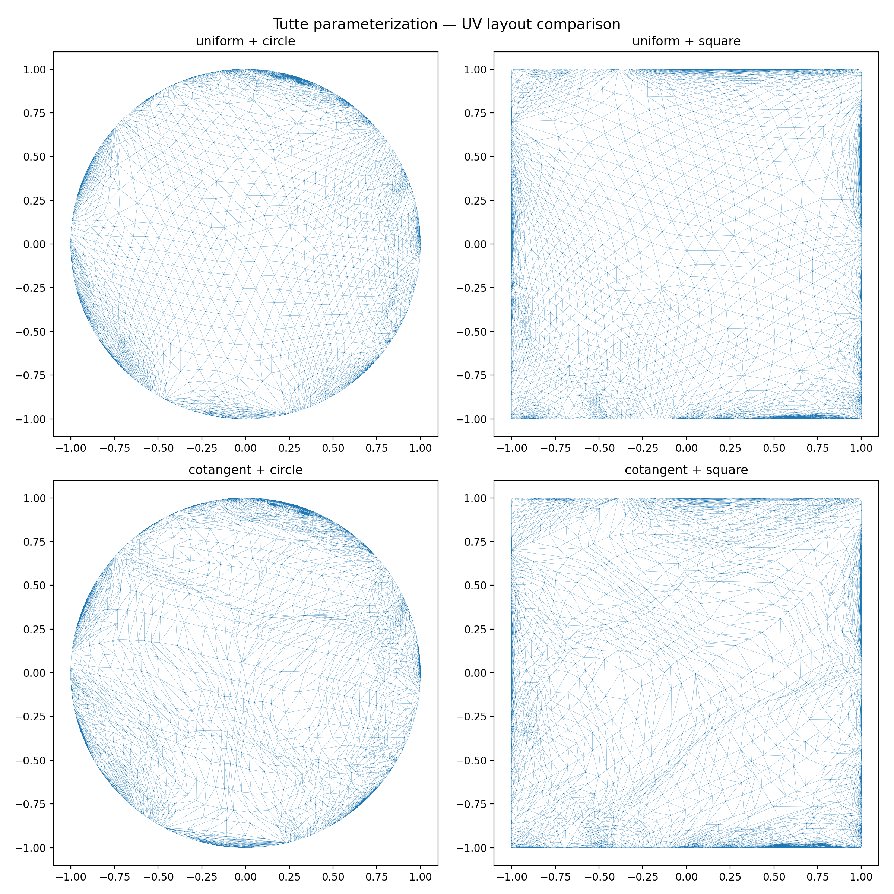
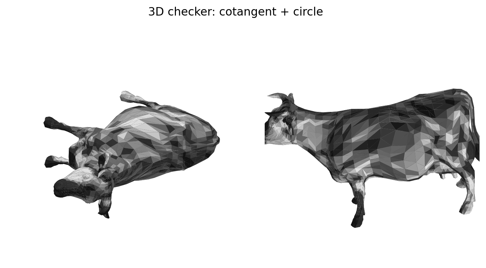
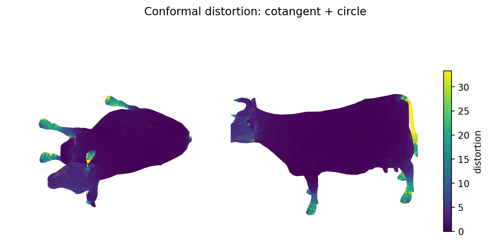

# 几何计算前沿 第二次作业 —— Tutte 网格参数化

**姓名**：刘智琦 &nbsp;&nbsp;**学号**：2300012860 &nbsp;&nbsp;**日期**：2026-04-20

---

## 1. 任务简介

本次作业选择**网格参数化**方向，对给定的 `parameterization.obj` 实现经典的
**Tutte 参数化**算法（Tutte 1963）。为了充分理解算法与代码实现，本作业还：

- 同时实现了**均匀权重**（经典 Tutte）和**余切权重**（离散调和映射）两种方案；
- 边界映射分别采用**单位圆**与**单位正方形**两种凸形，共得到 4 种组合；
- 同一算法写了两套实现：`numpy + scipy` 向量化版与 `OpenMesh` 半边结构版，
  用于对比两种代码风格；
- 定量评估结果：面翻转数、共形扭曲 σ_max/σ_min、面积比等。

## 2. 算法原理

### 2.1 Tutte 定理

设 $G = (V, E)$ 为平面三角网格（圆盘拓扑，单个边界环 $\partial V$）。
若：

1. 边界映射 $\phi|_{\partial V}$ 是到凸多边形的保序嵌入；
2. 对每个内部顶点 $i \in V \setminus \partial V$，存在正权重 $w_{ij} > 0$ 且

$$\phi(i) = \frac{\sum_{j \in N(i)} w_{ij}\,\phi(j)}{\sum_{j \in N(i)} w_{ij}}$$

那么 $\phi$ 是整个网格到凸域的**双射嵌入**（无翻转、无自交）。

该条件等价于在内部顶点处使离散 Laplace 方程 $L \phi = 0$ 成立，
以边界 UV 作 Dirichlet 边界条件即可求解。

### 2.2 权重选择

#### 均匀权重 $w_{ij} = 1$

对应图拉普拉斯 $L = D - A$。优点：严格满足 Tutte 正权重条件，**保证双射**；
缺点：完全不考虑几何信息，扭曲大。

#### 余切权重 $w_{ij} = \tfrac{1}{2}(\cot\alpha_{ij} + \cot\beta_{ij})$

其中 $\alpha_{ij}, \beta_{ij}$ 是边 $(i, j)$ 两侧对角处的内角。
该权重来自调和映射的有限元离散化（Pinkall & Polthier 1993），
**对光滑曲面上的调和函数是线性精度的**，保角性能好。

代价：三角形钝角时 $\cot < 0$，不再满足 Tutte 正权重假设，
对某些输入可能产生局部翻转（但在实践中很少见）。

### 2.3 求解

对所有顶点分块：$I$ 为内部、$B$ 为边界。把 $L$ 重排后分块：

```
| L_II  L_IB |   | φ_I |     | 0 |
|            | · |     |  =  |   |     ⟹     L_II · φ_I  =  − L_IB · φ_B
| L_BI  L_BB |   | φ_B |     | 0 |
```

$\phi_B$ 由边界形状决定（已知），于是只需解对称正定的稀疏线性系统。
UV 的 $u$、$v$ 分量互不耦合，可以共享矩阵分解一次求解。

## 3. 实现

### 3.1 环境

使用 pixi 管理环境，关键依赖：

```toml
[dependencies]
python        = "3.12"
numpy         = ">=2.4"
scipy         = ">=1.17"
trimesh       = ">=4.11"
openmesh-python = ">=1.2"
matplotlib    = ">=3.10"
```

运行：

```bash
pixi install
pixi run python src/main.py
```

### 3.2 目录结构

```
src/
  mesh_utils.py         # 边界检测、边界映射、扭曲度量
  tutte_numpy.py        # numpy + scipy 实现
  tutte_openmesh.py     # OpenMesh 半边结构实现
  visualize.py          # 可视化工具
  main.py               # 主流程 + 两种实现交叉验证
results/
  uv_*.png              # 2D UV 布局
  checker_*.png         # 3D 棋盘纹理贴图
  distortion_*.png      # 共形扭曲热图
  uv_comparison_grid.png
  parameterization_uv.obj
  summary.json
```

### 3.3 两种代码风格对比

Tutte 的核心在于构造拉普拉斯矩阵。这一步两种实现差异最明显。

#### numpy / scipy 风格（tutte_numpy.py）

对三角面数组 `F: (m, 3)` 做**向量化**操作，一次性算出所有三角形对邻点的贡献：

```python
def build_cotangent_laplacian(V, faces):
    n = V.shape[0]
    rows, cols, data = [], [], []
    for li in range(3):  # 三个本地顶点索引轮转
        i = faces[:, li]
        j = faces[:, (li + 1) % 3]
        k = faces[:, (li + 2) % 3]
        e1 = V[j] - V[i]
        e2 = V[k] - V[i]
        cot = np.sum(e1 * e2, axis=1) / np.linalg.norm(np.cross(e1, e2), axis=1)
        w = 0.5 * cot
        # 批量添加 COO 三元组 ...
    return sp.csr_matrix((data, (rows, cols)), shape=(n, n))
```

- 外层循环只有 3 次（而不是 m 次）
- 每次都处理所有三角形
- 数据紧凑、速度快，但**语义上需要读者理解向量化惯用法**

#### OpenMesh 半边风格（tutte_openmesh.py）

以"每个面，遍历三个顶点"的方式逐面计算，**语义更直接**：

```python
def build_cotangent_laplacian_hm(mesh):
    n = mesh.n_vertices()
    rows, cols, data = [], [], []
    for f in mesh.faces():
        vs = [v.idx() for v in mesh.fv(f)]
        pts = [mesh.point(mesh.vertex_handle(i)) for i in vs]
        i, j, k = vs
        vi, vj, vk = pts
        # 对每个顶点角 α_i 贡献 0.5*cot(α_i) 到对边 (j, k)
        for a, b, c, va, vb, vc in [(i,j,k,vi,vj,vk), (j,k,i,vj,vk,vi), (k,i,j,vk,vi,vj)]:
            e1, e2 = vb - va, vc - va
            cot_a = np.dot(e1, e2) / np.linalg.norm(np.cross(e1, e2))
            w = 0.5 * cot_a
            # 添加贡献 ...
    return sp.csr_matrix((data, (rows, cols)), shape=(n, n))
```

OpenMesh 的额外能力（半边遍历、对偶半边、`is_boundary(he)` 等）在更复杂的
拓扑算法（如环路切割、孔洞填充）中会更发挥作用；对 Tutte 这种线性代数任务，
两种方案数学上完全等价。

#### 数值等价性验证

`main.py` 中断言两种实现数值一致：

- `uniform`：`‖UV_numpy − UV_openmesh‖ = 0.00e+00`
- `cotangent`：`‖UV_numpy − UV_openmesh‖ = 9.86e-07`（来自浮点求和顺序）

### 3.4 边界检测

两种实现方式：

- **numpy 版**：统计每条无向边出现的次数，等于 1 的是边界边；
  沿邻接表走环。
- **OpenMesh 版**：用半边结构，`is_boundary(he)` 一行判定；
  沿 `next_halfedge_handle` 走环（边界半边的 next 仍是边界半边）。

两种方式得到的边界顶点集合完全一致（同一个 584 个顶点的环）。

### 3.5 边界形状映射

按原 3D 空间弧长比例，把边界顶点等比分布到：

- **单位圆**：$\theta_i = 2\pi \cdot \ell_i / L$，UV $= (\cos\theta, \sin\theta)$
- **单位正方形**：$t_i = \ell_i / L \in [0,1)$，按 $t$ 分到 4 条边

## 4. 实验结果

### 4.1 输入网格

| 属性 | 数值 |
|------|------|
| 顶点数 | 3195 |
| 面数 | 5804 |
| 边界环长度 | 584 |
| Euler 示性数 χ | 1 |
| 拓扑 | 圆盘（disk） |

网格为一个**牛形**模型（含牛角、尾巴、四肢），在其身体某处被"割开"得到圆盘。

### 4.2 定量对比

| 组合 | 求解时间 | 真翻转面 | 退化面 | 共形扭曲均值 | 共形扭曲 p95 |
|------|---------|---------|--------|-------------|-------------|
| uniform + circle   | 0.03 s | **0** | 0  | 11.23  | 30.92  |
| uniform + square   | 0.03 s | **0** | 67 | 69.52  | 98.52  |
| cotangent + circle | 0.04 s | **0** | 0  | 11.44  | 33.34  |
| cotangent + square | 0.04 s | **0** | 67 | 145.03 | 400.17 |

- **真翻转面始终为 0**：与 Tutte 定理预测一致，四种组合都得到双射映射。
- **退化面**只出现在方形边界上：这些是 3 个顶点都在边界的三角形，
  在方形的一条直线边上被挤平到面积 $\approx 0$，**不是折叠**，是直线共线。
- **共形扭曲**圆形远优于方形；均匀与余切差异不明显，
  原因是该输入网格本身几何非常复杂（附肢细长），
  两种权重的差异被几何本身的不可展性淹没。

### 4.3 可视化

#### UV 布局对比（2D 平面三角网格）



四种方案的 UV 布局均为合法嵌入，边界准确对应到圆/方形，
内部三角形分布密集反映了原网格的不均匀性——牛角、蹄、尾被挤入**边界附近**，
躯干占据**中心大面积**。

#### 3D 棋盘纹理



在 3D 模型上根据 UV 采样棋盘颜色可以直观观察参数化的**尺度畸变**：

- 牛体躯干：棋盘格大小较均匀 → 扭曲低
- 四肢、尾、角：棋盘格被极度拉伸 → 扭曲大（这些细长特征被挤到边界附近后，
  每个方向的 UV 范围都被极度压缩或拉伸）

#### 共形扭曲热图



颜色表示每三角形的 $\sigma_{\max}/\sigma_{\min} - 1$，数值越大扭曲越重。
扭曲集中在：

- 牛角尖端、蹄尖、尾端等 **1-ring 邻域少的突出特征**
- 躯干主体区域（大面积平面）扭曲最低，是圆盘参数化表现最好的区域

## 5. 讨论

### 5.1 为什么方形比圆形扭曲大？

圆是光滑凸曲线，边界方向变化连续；正方形在 4 个角处有 $\pi/2$ 转角突变，
这种"边界奇异点"会向内部顶点传播为**高扭曲区**（从图中可见方形角附近的
三角形严重拉伸）。另外方形还会**压平 3-边界三角形**为退化面。

### 5.2 为什么均匀与余切差异不明显？

理论上余切（调和）映射应比均匀映射更接近共形映射。但在这个**高度各向异性
+ 强曲率**的网格上：

- 余切权重对表面曲率是"感知"的——高斯曲率大的地方（角、蹄）本身就是
  度量不可展点，再精细的权重也救不了它；
- p95 扭曲（30.9 vs 33.3）和均值（11.2 vs 11.4）几乎相同，说明**扭曲
  主要由几何决定**，权重影响有限。

如果要真正降低扭曲，需要：

- **ARAP 参数化**（迭代尽量保长）
- **LSCM / ABF**（保角映射，允许边界自由）
- **分片参数化**（把网格切成多块，分别参数化）

### 5.3 复杂度

Tutte 的成本由稀疏线性系统主导。对 $n = 3195$ 个顶点，$O(n^{1.5}) \sim 10^5$
级别的稀疏分解，scipy `spsolve` 约 30 ms 完成。此方法可轻松扩展到百万顶点
规模（使用 Cholesky 预分解 + 两次回代解 $u, v$）。

## 6. 如何复现

```bash
# 1. 安装环境（首次，大约需要下载 200 MB）
pixi install

# 2. 运行主脚本，生成所有结果
pixi run python src/main.py

# 3. 重新生成本报告 PDF
pixi run python src/build_report.py
```

产物：

- `results/uv_*.png`：四种组合的 UV 布局
- `results/checker_*.png`：3D 棋盘贴图（两视角）
- `results/distortion_*.png`：共形扭曲热图
- `results/uv_comparison_grid.png`：2×2 对比总览
- `results/parameterization_uv.obj`：带 UV 的 obj（cotangent+circle）
- `results/summary.json`：数值指标

## 参考文献

1. W. T. Tutte. *How to draw a graph*. Proc. London Math. Soc. 1963.
2. U. Pinkall, K. Polthier. *Computing Discrete Minimal Surfaces and Their Conjugates*. Experimental Math. 1993.
3. K. Hormann, B. Lévy, A. Sheffer. *Mesh Parameterization: Theory and Practice*. SIGGRAPH Course Notes 2007.
